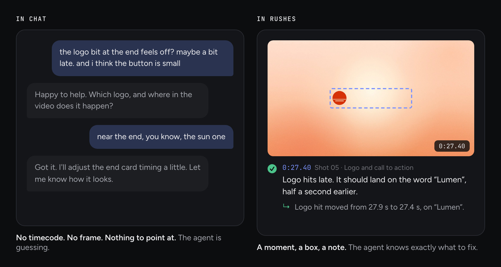
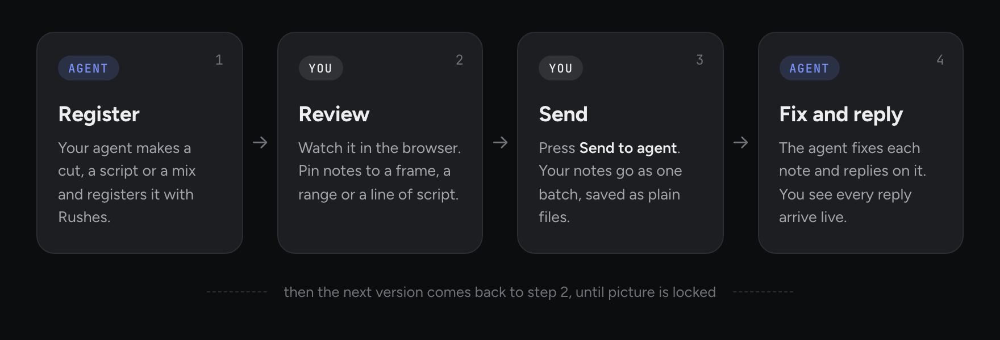
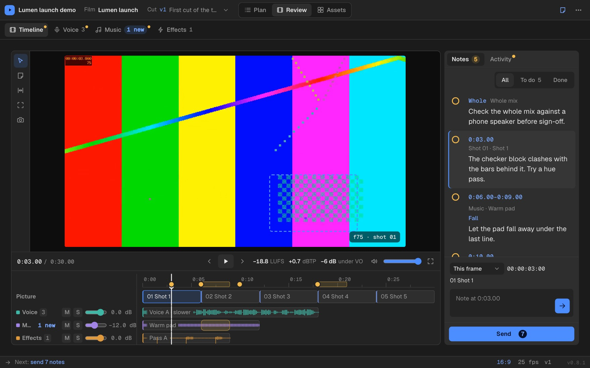
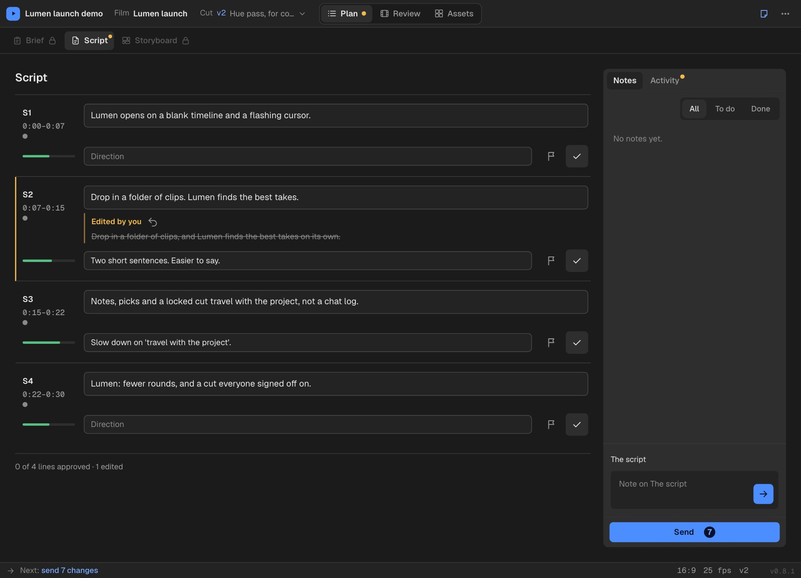
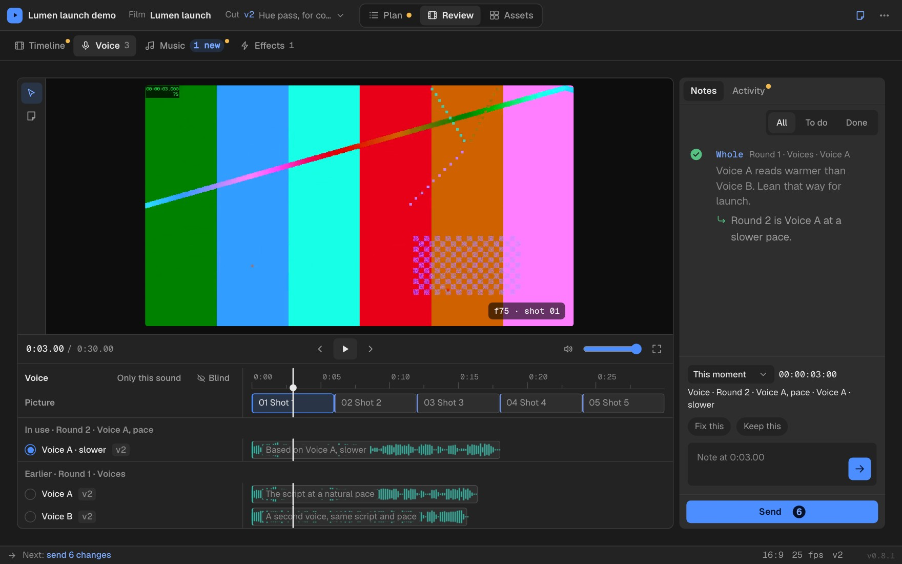
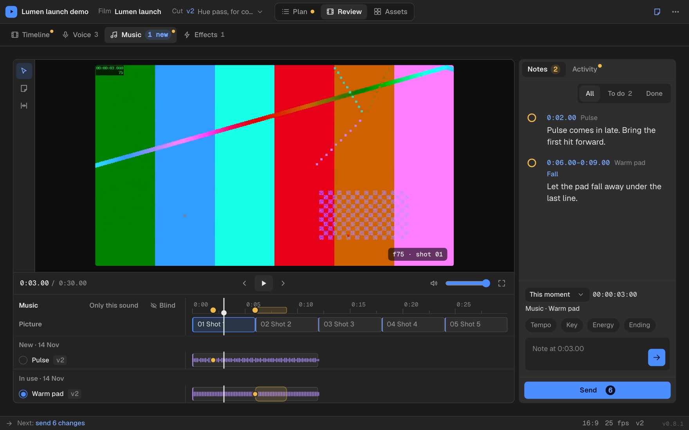
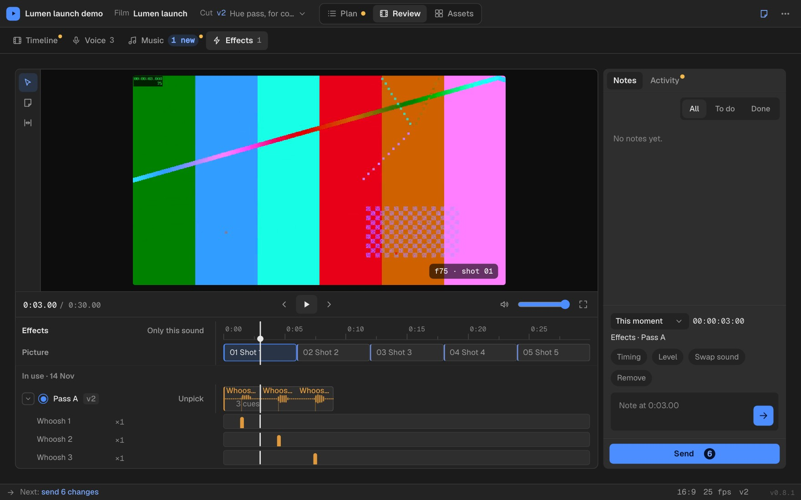
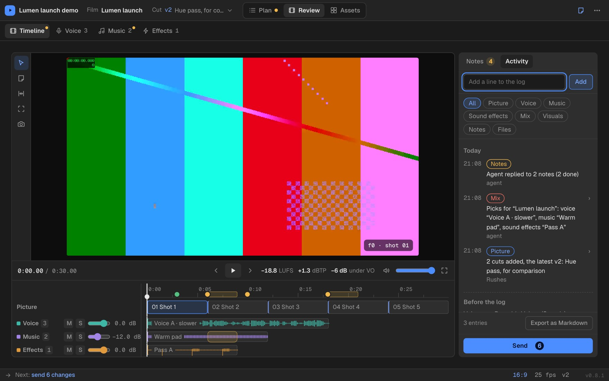
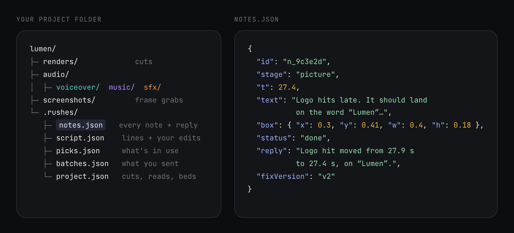

<p align="center">
  <picture>
    <source media="(prefers-color-scheme: dark)" srcset="docs/brand/lockup-dark.svg">
    
  </picture>
</p>

<h3 align="center">Your agent shoots. You give notes.</h3>

<p align="center">
  The review desk for video made with AI agents. Pin notes to the exact frame, edit the script,<br>
  pick the voice and the music. Your agent reads every note and fixes it.
</p>

<p align="center">
  <a href="https://www.npmjs.com/package/rushes"></a>
  <a href="LICENSE"></a>
  <a href="https://nodejs.org"></a>
  
  
</p>

<p align="center">
  <a href="#get-started">Get started</a> &nbsp;·&nbsp;
  <a href="#how-it-works">How it works</a> &nbsp;·&nbsp;
  <a href="#every-stage-in-one-place">The desk</a> &nbsp;·&nbsp;
  <a href="#your-notes-are-plain-files">Plain files</a> &nbsp;·&nbsp;
  <a href="#faq">FAQ</a> &nbsp;·&nbsp;
  <a href="#for-agents-set-yourself-up">For agents</a>
</p>

https://github.com/user-attachments/assets/b9b3d872-297a-4afc-8657-902d11d175a1

## Chat is a poor place to review a film

More and more video is made by agents. Claude, Codex and the rest can write the script, render the cut, and generate the voiceover, the music and the sound effects. What they can't do is show you the work. You get a folder of files and a filename. Then you type "the logo bit at the end feels off" into a chat box, and the agent asks which logo, and where.

Rushes is the desk that's missing. It shows each stage of the work in your browser, lets you mark it up the way an editor would, and hands every note back to your agent with the exact moment, box or line it's about.

<p align="center">
  
</p>

## Get started

Tell your agent:

> Use github.com/iamredmh/rushes to start a new film.

That's all. Your agent reads [the setup steps for agents](#for-agents-set-yourself-up) and sets itself up. Then it asks you up to three questions, writes a brief and a script for you to approve, sketches the shots, and only builds once you've said yes.

Already have a film? Tell your agent:

> Use github.com/iamredmh/rushes as my review tool for video, voiceover and music.

If you started it in the chat, your agent writes the brief from the conversation and registers the script, stills and files you've already made, and says what it had to guess.

It runs on your machine. There's no account, no API key and no server to sign up for. You need [Node.js](https://nodejs.org) 22.12 or newer, on a Mac, Windows or Linux.

No project to hand? `npx -y rushes demo` builds an example on your machine and opens it.

> Status: early. The Plan, Review, Visuals and Assets workspaces, the MCP tools and the CLI all work today.

## How it works

<p align="center">
  
</p>

Your agent registers what it makes. You review it in the browser. When you press **Send**, at the foot of the notes panel, your notes go as one batch, saved as plain files in your project. The agent reads the batch, fixes each note and replies on it, and you see each reply arrive.

## Every stage in one place

Four workspaces in the top bar, in the order the work happens; the first, Plan, has a switch for Brief, Script and Storyboard. **Review** holds the cut on the **Timeline** tab and a tab for each sound: **Voice**, **Music** and **Effects**. Then come **Visuals** and **Assets**. A tab unlocks as soon as it has something in it, and a locked tab tells you what to ask your agent for. The notes panel sits on the right, with its **Notes** and **Activity** tabs and **Send** at its foot. On Visuals and Assets, which have no notes panel, the status bar at the bottom offers **Send** while anything is waiting.

### Timeline: point at the exact frame



Pin a note to a moment, to a range, or to a box drawn on the frame. Grab a frame to show what you mean. Every note records the shot it falls in.

### The agent replies on every note


When the agent delivers a new cut, each note shows where it landed in the new version and what the agent did about it. A green tick means it's done. Anything the agent didn't fix stays open, with a reason.

### Plan: the brief, the script and the storyboard



Rewrite a line, add a direction, flag it or approve it. Every line sits in a field; once you change one, its row says **Edited by you**, with the agent's wording struck through beneath it and a button to go back to it, and the change goes with your next **Send**. The bar on each row shows whether the line still fits its slot. When the agent adopts your edit, it records the next voice read from the corrected script.

Plan is one workspace, so planning never crowds the review. A switch at its top opens **Brief**, **Script** and **Storyboard**, each with a tick once it is approved and a dot while it has edits you haven't sent; key `1` comes back to the page you used last. **Brief** shows `brief.md` in your project folder, one field per section. Edit a section and Rushes writes it into the file; press **Approve brief** and it sets the file's status line. If your agent rewrites `brief.md`, the page follows without a reload. **Storyboard** works the same way over `storyboard.md`: a row per shot with its still (click it to enlarge), its description, a direction line and a tick to approve it. A line at the foot of each page counts what is approved and what you have edited. When the brief, every script line (if the film has a script) and every shot are approved, the Plan tab in the top bar shows a green check and the row above the page says **Ready to build**, with a prompt to copy. Rushes never stops your agent building before then: it only says what is still waiting.

In a project with several films, each film has its own brief, script and storyboard, and every tab shows only the film selected in the top bar (it is in the address, `?film=`, so a reload or a shared link keeps it). The first film keeps `brief.md` and `storyboard.md` at the project root; every other film's are in `films/<film-id>/`. Visuals are the one exception: they are campaign material, so they show on every film, marked **Shared**. Notes, takes and files from before a project had a second film are moved once to its first film.

### Voice: compare reads, round by round



Reads of the same script sit side by side in rounds. Switch between them with no gap in playback, or turn on **Blind** to hide which is which. Leave a note on a whole read, or at a point in it. Each sound's tab lists its takes as **New**, **In use**, **Earlier** and **Put away**; a take isn't on the timeline until you pick it.

### Music: audition the beds



Switch beds instantly while the picture plays. Mark a range as **Rise**, **Fall**, **Louder** or **Quieter**, and your agent gets it as a note it can act on.

### Visuals: mark up stills and carousels

The **Visuals** workspace (key `7`) is for the stills, standalone images and carousels your agent makes next to a video. Each is a visual: one post, in the aspect ratios it comes in, shown one page at a time in a large frame. It scrolls from one visual to the next, and whichever visual crosses the middle of the view is the current one: it gets the outline, and it is the only one you can add a note to. A carousel has Previous and Next, a count, **Full screen** (for looking closely; you mark in the workspace) and a strip of its pages with the open notes on each.

**Drag** on the picture to mark a region, click to drop a point, or press **Whole image** for a note about all of it. The composer always says where the note will go ("Adding to: Launch carousel · page 3 · 4:5 · v2"), and a draft stays with the visual you began it on. Notes belong to a page, a ratio and a version, never to where you have scrolled, so every mark is still there when you come back. The notes column lists the whole workspace, grouped by visual and page, with the visual you are looking at highlighted and the rest faded; click a note to jump to it. When your agent registers a new version, your old notes stay with the version they were made on ("from v1"), marked until you tick them done.

### Shelve a film

A film that went nowhere can be set aside without losing it. Open the **More** menu (**⋯**, at the right of the top bar) and choose **Shelve film**, or press **Shift+S**. The film leaves the **Film** menu's films in play, a toast offers **Undo**, and its open notes stop counting: they leave the Send count, the tab to-do counts, batches and Export notes, and they come back when you restore the film. Nothing is deleted: its cuts, notes, picks and files stay as they were.

The **Film** menu in the top bar switches films, each listed with its open notes. **Shelved (N)** at its foot lists the shelved films: choose one to look at it, view-only, under a "Shelved" banner, and **Restore** it from the menu or the banner. A new cut from your agent also brings a shelved film back. Your agent can see which films are shelved, but never shelves or restores one.

### Effects: layers by sound



Every cue is labelled on the waveform. Open the pass into **layers by sound**: one row per sound, with a count, and a tick wherever it plays. Click a layer's file to hear that sample on its own.

### Everything together on the Timeline


There is no separate mix: the takes in use play together against the picture on the **Timeline** tab. Each sound has its own row there with mute (**M**), solo (**S**) and a level, and the tab reads the loudness and true peak (with ffmpeg installed).

The Timeline's notes list holds the film's notes from every tab: Voice, Music and Effects notes sit beside the picture's, each with a small tab label ("Voice · Eliza, read 3"), and "(not in use)" when its take isn't the one playing. Clicking a note's time seeks the timeline there. On Voice, Music and Effects, **All tabs** beside the filter shows the same film-wide list.

### Activity: the Change Log



Rushes keeps a running log of what happened, in the **Activity** tab of the notes panel: each cut, read, bed and pass as it arrives, notes sent, and the agent's replies. Export it as Markdown for whoever needs to catch up.

## Why Rushes

- **Notes your agent can act on.** Each one carries its stage, a timecode or range, an optional box on the frame, a frame grab, and the shot it falls in.
- **Everything in one batch.** **Send** sends every open note from every tab of the film you are on, wherever you press it, so nothing waits behind. In a project with several films, a batch is about one film.
- **Versions keep their history.** Notes follow the work from cut to cut, and you can lock picture when it's done.
- **Local, with no sign-up.** No account, no API key, nothing uploaded. It runs on your machine.
- **Works with the agent you already use.** One MCP server for Claude Code, Codex, Cursor, Claude Desktop and Gemini CLI, a plugin and skill for Claude Code, and a command line for anything else.
- **Plain files, so the work is yours.** Notes, script and picks live in your project folder. Commit them with the rest.

## Your notes are plain files

<p align="center">
  
</p>

Rushes keeps your review in a `.rushes/` folder in the project. The agent reads those files, fixes the work and writes its reply back, and a single local server is the only thing that writes to them. Add `.rushes/` to git if you want your review history kept with the project. More in [What gets saved](#what-gets-saved).

## FAQ

**Does my video leave my machine?** No. Rushes serves the review desk from your own computer and reads your project folder from disk. There's no upload, no account and no key.

**Which agents does it work with?** Any that can run a local MCP server: Claude Code, Codex, Cursor, Claude Desktop and Gemini CLI today. Agents with no MCP support can use the command line. See [Manual setup](#manual-setup).

**Can I use it without an agent?** Yes. Review, leave notes, and run **Export notes** for a dated Markdown file you can send to a person. The agent loop is where it pays off most.

**Does it need ffmpeg?** No, but it helps. With ffmpeg installed Rushes reads frame rates and durations, makes browser-playable proxies of heavy cuts, and measures loudness on the Timeline tab. Run `rushes doctor` to check.

**Can it handle big files, or a slow connection?** Rushes makes lighter proxies of your cuts, at a quality you choose, and a toolbar button switches between them and the originals. Your originals are never changed. See [Proxies](#proxies).

**Where do I report a bug or ask for something?** [Open an issue](https://github.com/iamredmh/rushes/issues). Please say which agent and operating system you're using, and attach the output of `rushes doctor`.

---

The rest of this page is the reference: setup for agents, manual setup, the command line, shortcuts and every feature in detail.

## For agents: set yourself up

If your user asked you to use Rushes, do this:

1. Run this once. It finds every supported harness on the machine and registers the Rushes MCP server, plus the Rushes skill where the harness supports skills:

   ```bash
   npx -y rushes setup
   ```

   (Before publishing to npm, the GitHub form also works: `npx -y github:iamredmh/rushes setup`.)

   It prints one line per harness. Existing config is kept and a `.rushes.bak` backup is written first. Run it with `--dry-run` first if you want to show the user the changes before making them. A machine already set up through the GitHub form is recognised as Rushes too — setup switches it to the npm launch instead of adding a second registration.
2. If it added anything, tell the user to restart the app (or start a new session) so the `rushes_*` tools load.
3. From then on, follow [AGENTS.md](AGENTS.md). If the user wants a new film, start with **Starting a film** in AGENTS.md: plan it with them first, then build. Otherwise, in short: register what you made, call `rushes_open`, wait for the user to press **Send**, then `rushes_get_batch`, fix the notes, and `rushes_reply`.

The MCP server has twenty-six tools: `rushes_open`, `rushes_status`, `rushes_add_version`, `rushes_add_format`, `rushes_add_visual`, `rushes_add_variant`, `rushes_set_films`, `rushes_set_script`, `rushes_get_script`, `rushes_add_take`, `rushes_list_notes`, `rushes_list_assets`, `rushes_get_batch`, `rushes_reply`, `rushes_attention`, `rushes_working_on`, `rushes_get_picks`, `rushes_set_shots`, `rushes_lock_picture`, `rushes_add_file`, `rushes_export_notes`, `rushes_log`, `rushes_get_log`, `rushes_scan`, `rushes_bring_in` and `rushes_doctor`.

If you can't run commands, give the user the matching line from **Manual setup** below.

## Manual setup

| Harness | How |
|---|---|
| **Claude Code**: plugin, which includes the skill | `/plugin marketplace add iamredmh/rushes` then `/plugin install rushes@iamredmh` |
| **Claude Code**: MCP only | `claude mcp add --scope user rushes -- npx -y rushes mcp` |
| **Codex** | add to `~/.codex/config.toml`:<br>`[mcp_servers.rushes]`<br>`command = "npx"`<br>`args = ["-y", "rushes", "mcp"]` |
| **Cursor** (`~/.cursor/mcp.json`), **Claude Desktop** (`claude_desktop_config.json`), **Gemini CLI** (`~/.gemini/settings.json`) | `{ "mcpServers": { "rushes": { "command": "npx", "args": ["-y", "rushes", "mcp"] } } }` |

On Windows, `rushes setup` writes the launch as `cmd /c npx -y rushes mcp` (in JSON: `"command": "cmd", "args": ["/c", "npx", "-y", "rushes", "mcp"]`), because harnesses can't start `npx` directly there. Do the same if you set it up by hand.

### Other harnesses

Any MCP client that can launch a local stdio server works. Point it at `npx -y rushes mcp`. Agents with no MCP support can use the CLI instead (`rushes add`, including `rushes add format` for another shape of a cut, `rushes notes`, `rushes reply`): see [AGENTS.md](AGENTS.md).

ChatGPT's apps can't run local MCP servers yet. Use Codex, OpenAI's agent, instead.

## Use it yourself

```bash
cd your-project
npx -y rushes open    # opens the review desk in your browser
npx -y rushes stop    # stops it
```

`rushes open` also looks through the folder for the files that go with the cut, and says what it brought in and what it left (see **Finding your other files**).

Each project opens at its own address, `http://127.0.0.1:4580/p/<id>/` — safe to run several projects at once.

A server your agent starts in the background stops by itself after two hours with nothing connected.

### Start a film: `rushes new`

```bash
npx -y rushes new my-film    # creates ./my-film and opens it
```

It makes the project folder with `renders/` and `audio/` ready, and a `brief.md` for your agent to fill in with you. You say yes to the brief, the script and the storyboard before anything is built. A folder that's already a Rushes project is refused, and an existing `brief.md` is never overwritten. Pass `--name` to set the project's name and `--no-browser` to skip opening it.

### Try it first: `rushes demo`

No project to hand? Build one:

```bash
npx -y rushes demo    # creates ./rushes-demo and opens it
```

It generates a complete example on your machine — a 30 s test film in two cuts, a short script, voice reads in two rounds, two music beds, an SFX pass, and example notes on the cut, the voice reads, the music and the mix — so every tab has something in it from the start. Nothing is downloaded and nothing ships with Rushes; it's all made locally with ffmpeg and, where available, your system's text-to-speech. It needs ffmpeg — without it, `demo` says so and points you at `rushes doctor`. It refuses to write into a folder that isn't empty. Pass a folder name to put it somewhere else, and `--no-browser` to skip opening it.

### Health check: `rushes doctor`

```bash
npx -y rushes doctor          # Node, ffmpeg, which agents have Rushes, this project, free disk space
npx -y rushes doctor --json   # the same checks as data
```

Each check prints ✓ or ✗ with a plain fix, e.g. `✗ Claude Code — the Rushes MCP server isn't registered. Fix: rushes setup --only claude-code`. Only the Node version (and, inside a project, its files) has to pass; ffmpeg is recommended (proxies and loudness need it) but not required, and doctor warns when your ffmpeg was built without libx264, which proxies and the demo encode with. Run it from inside a project folder to add file, server and disk checks. Agents get the same checks from the `rushes_doctor` tool.

## Shortcuts

On the Timeline tab:

- **Space** play or pause
- **←/→** step one frame (Shift: ten)
- **I/O** set in and out
- **B** draw a box
- **G** grab a frame
- **N** new note
- **V** the select tool
- **F** full screen
- **P** proxies on or off

On the Voice, Music and Effects tabs:

- **Space** play or pause
- **←/→** step one frame (Shift: ten)
- **I/O** set in and out
- **N** new note
- **←/→** with a cue or a layer's tick focused: the previous or next cue (**Home**/**End**: the first or last); **Enter** moves the playhead there; **Esc** hides the card

Anywhere:

- **1–8** switch place (1: Plan, which opens the page you used last; 2 and 6: Timeline; 3, 4, 5: Voice, Music, Effects; 7: Visuals; 8: Assets)
- **\\** hide or show the notes panel
- **[ / ]** previous/next film in play
- **Shift+S** shelve the current film, or restore it if it is shelved
- **Alt+←/→** previous/next format (Timeline)
- **?** shortcuts
- **Esc** close

## Locked tabs

Every tab is visible from the start, in workflow order, even before there's anything in it. A locked tab isn't a dead end: open it and it explains itself — what the tab is for, what unlocks it, and a **Copy prompt for your agent** button that copies a ready-to-paste request naming your project, the film, and the tool your agent should use, e.g.:

> In Rushes project "Launch", make two or three music beds for "Hero" and add each with rushes_add_variant (stage "music") with a one-line description.

When the project's folder already holds files for a locked Voice, Music or Effects tab, its page also says how many were found and offers a **Review** button, such as "14 music files found in this project". See **Finding your other files**, below.

Hovering a locked tab shows a short tooltip, e.g. "Locked: ask your agent for music beds". The Assets workspace follows the same rule.

## Send to AI

Send to AI hands your notes to an agent on your computer, so there's no prompt to paste. It works the same on a Mac, Windows and Linux. All you need is Node.js and the agent itself. It starts your own Claude Code or Codex in the project folder, signed in your way (a Claude or ChatGPT plan, or an API key), so every run is billed to that account, just as if you had typed the prompt yourself. Nothing goes through iCloud or any other cloud service.

**The connector.** Rushes talks to each agent through a connector: the Agent Client Protocol adapter for Claude Code or Codex. It's about 80 MB for Claude Code and 20 MB for Codex, and it uses the agent you already have rather than a copy of its own. Rushes downloads it once per version, in the background, when you open a project with that agent installed, or when you run `rushes setup`. It's kept in your cache folder: `~/Library/Caches/rushes` on a Mac, `%LOCALAPPDATA%\rushes\Cache` on Windows, `~/.cache/rushes` on Linux, or `$XDG_CACHE_HOME/rushes`. Until it's ready, the sheet and the agent's menu say "Getting Claude Code ready…". A Send made meanwhile waits for it. The download goes through your own npm settings (registry, proxy). A project's own `.npmrc` is never used.

**Installing an agent.** An agent that isn't installed shows its install command with a Copy button: `npm install -g @anthropic-ai/claude-code` for Claude Code, `npm install -g @openai/codex` for Codex. One older than Send to AI is tested with (Claude Code 2.0, Codex 0.163) shows its update command instead. `rushes doctor` checks each agent: installed, version, signed in, and connector downloaded.

Rushes never sees a password or key, and never signs you in. When an agent isn't signed in, the sign-in button opens a terminal with that agent's own login command (`claude auth login` or `codex login`) for you to run there. It reads **Sign in in Terminal** on a Mac, **Sign in in Command Prompt** on Windows and **Sign in in a terminal** on Linux. Where no terminal can be opened, the desk shows the command to copy.

**The switch.** Above **Send**, a row reads **Send to AI** with the agent's name and a switch. On, Send files the batch as always and hands it to the agent: what it is doing shows on each note and in Activity, and each note gets a short reply saying what it did. Notes go one way: the agent never asks you anything on a note, and to follow up you write a new note on the same moment. When it can't go on without you outside Rushes (a sign-in, a missing key), Activity shows one **Needs your attention** item in the alert colour, and the Activity tab's dot turns that colour; clicking the item takes you back to the agent's conversation: a terminal resuming it on the same computer, or the command to copy and where to run it when the desk is on another one. **Dismiss** clears it, as does the note being done. Off, Send copies the prompt, as before. Under Send, one line says what the agent may do: "Edits files in this project, asks before commands" or "Asks before everything", and "next Send continues the conversation" when there is one to continue.

The first time you press Send, a sheet asks "Who should get these notes?" (an agent, or copy a prompt as before), then "What may <agent> do without asking?". It asks once per Mac, not once per project: your answer is kept as the default, and every new project starts from it, so Send goes straight to your agent there. The last choice you make in the sheet, the agent's menu or the switch turned on is the default; turning Send to AI off on one project leaves it as it is.

If the agent fails to start, the notes go back in to do and nothing is copied. If Send to AI is not set up, not signed in or not installed, Send opens the copy dialog with the prompt and says why, with **Set up**: once you finish the sheet it opens, the notes in that dialog go to the agent. A note says it is with the agent by name only while the agent has it. Lines about the brief and the storyboard are not handed to the agent yet: when they changed, Send hands over the notes and opens **Message for your agent** with those lines, saying the agent has the notes but not these lines, for you to copy to it yourself.

The agent's name opens a menu to choose another agent, **Start a fresh conversation**, change what it may do without asking, and see the "Always" rules. **Stop** ends a run and gives its unfinished notes back.

**New cuts.** When the agent adds a version and nothing holds the picture, the desk switches to it and a toast says so, such as "v3 is in". When something does (a cut or a sound playing on any tab, a note or mark you are making, or a locked picture), the picture stays where it is: the toast offers the cut with **Show**, and the **Cut** menu shows a dot until you look. The agent only adds a version when the picture or sound changed, and it is asked to wait for its commands to finish before it replies, so a run does not leave work going in the background.

**Permissions.** The agent's menu, and the sheet's second step, offer four rows, the same for Claude Code and Codex:

- **Manual** (always ask): every action asks.
- **Accept edits** (the default): the agent reads, edits, searches, moves and deletes files inside the project folder without asking. Commands, the network and anything outside the folder ask first, unless an Always rule covers them. The line under Send reads "Edits files in this project, asks before commands"; under Manual it reads "Asks before everything".
- **Auto** (the agent decides): the agent's own safety reviewer approves or refuses each step (Claude Code's auto mode, Codex's Auto review). Rushes sees only what the agent chooses to ask, and no longer guards `.rushes` and `.git`. If Claude Code's model can't run auto mode, Claude falls back to accepting edits and asking for commands, and Activity says so.
- **Bypass** (accepts everything): nothing asks and nothing is checked, `.rushes` and `.git` included. Picking it shows a one-line warning. It is never a default: a new project never starts in Bypass.

A change of row applies from the next Send. A batch already running keeps the row it started in; the agent starts again (continuing the conversation) when the next Send needs another mode. Auto and Bypass are chosen only by you, in the menu or the sheet, never by anything in a project. Auto can be your default for new projects, like any row you pick; a brand-new Mac starts in Accept edits.

Under Manual and Accept edits, some folders and files in the project always ask, whatever "Always" rules you keep, even to read them: they hold settings, hooks or tokens. They are `.rushes/`, `.git/`, `.claude/`, `.codex/`, `.mcp.json`, `.vscode/` and `.idea/`. Moving or deleting the project folder itself always asks too.

An ask shows what the agent wants to do and the exact command, with **Allow once**, **Always** and **No**. It waits until you answer. It never turns into a yes by itself. When the agent asks, or ends a run with a question, and no Rushes tab is open, your computer shows a notification saying the agent is waiting in this project (on Linux when `notify-send` is installed).

Rushes sees only what the agent asks it. The agent's own permission settings, such as allow rules in Claude Code's settings, can still approve actions without asking, and Rushes never sees those.

With Codex under Manual or Accept edits, commands that write files or reach the network ask, but commands that only read, such as searches and listings, run without asking.

**"Always" rules.** **Always** keeps a rule for this project, so the same request runs without asking next time. The button names the rule, such as "Always for npx hyperframes here". The agent's menu lists the rules, and you can remove any of them. Always rules are kept in your user settings, outside the project, so the agent cannot change them. The permission level, the rules, whether you have answered the first-Send sheet and which agent you turned Send to AI on for are in `~/.config/rushes/agent-rules/` (`%APPDATA%\rushes\agent-rules\` on Windows, or under `$XDG_CONFIG_HOME`), one file per project. That agent is set only when you turn Send to AI on, in the sheet, the agent's menu or the switch. Copy a prompt and switching off clear it, and changing what it may do leaves it as it is. `.rushes/agent.json` keeps the project's switch, its agent and the conversation to continue. Nothing secret. Send hands notes to an agent only when that switch is on and its agent is the one in your file. Otherwise Send to AI shows as off and Send copies the prompt, so a project folder from someone else, or anything that writes `agent.json`, can't start an agent you didn't choose. A project set up with an earlier build asks once more. The default for new projects is `~/.config/rushes/agent-defaults.json` (the agent and what it may do, never Always rules, which stay per project). It is yours, outside every project, so nothing in a project can set it.

"Always" trusts one program and subcommand, such as `npx hyperframes`, `npm install` or `git commit`. Later commands that start with the same two words run without asking, whatever their other arguments. That trust covers whatever that program and subcommand can be told to run:

- options that start other programs, such as `git grep -O`, `rg --pre`, `ssh -o ProxyCommand`, `find -exec` and `npm run --script-shell`;
- project scripts that `npm run`, `bun run` and `go run` execute, and a package `npx` finds in the project's own `node_modules`;
- packages that `npm install`, `npm init`, `npm create` and `npm explore` fetch and run;
- services that `docker compose run` starts.

Rushes never offers "Always" for:

- a shell, or a wrapper such as `nohup` or `sudo`;
- a quoted or spaced program path;
- a subcommand that runs any package or program (`npm exec`, `npm x`, `pnpm dlx`, `uv run`, `uv tool`, `docker container`, `deno run`, `nix run`);
- one package runner run through another (`npx npm`, `bunx pnpm`, `npx pnpm@9`, `npx @pnpm/exe`, `uvx poetry`);
- a request to read, edit, search, move or delete a file outside the project or in one of the folders above.

## The Change Log

The **Activity** tab of the notes panel (what was the Change Log button) is a log of what happened, newest first and grouped by day:

- each cut, format (another shape of a cut: "9:16 added to v2"), voice read, music bed, sound-effects pass and take as it arrives;
- the script, picks and notes sent;
- the agent's replies.

Rushes writes it itself, one short line per event, and a burst of registrations is one line. You can:

- type a line of your own at the top;
- filter by tab;
- click a line to open that cut or variant.

A dot on the Activity tab means new lines since you last looked. **Export as Markdown** writes `exports/change-log-<date>.md`; **Export notes** (in the More menu, or in Assets › Exports) writes it too, beside the notes. A project made before the log existed starts it from the dates it already has (cuts, notes sent and files); its older audio is listed undated, under "Before the log".

The Cut menu's version list shows each cut's short label (the agent's, or one taken from its note) and how long ago it arrived, with its full note beside the list.

Agents read and write the same log with `rushes_get_log` and `rushes_log`, or from the command line:

```bash
rushes log --limit 20          # newest first
rushes log --area music
rushes log --md                # the same Markdown the export writes
rushes log add "Kept the wide shot" --area picture
rushes log add --area mix -- "-3 dB on the bed"   # text that starts with a dash goes after --
```

## Finding your other files

An agent only shows what it registers, but the work that goes with a cut usually sits in the same folder: the voiceover, the music, the effects. So when a project is opened, Rushes looks through the folder itself, and brings in the **current set** for the newest cut so those tabs have something to review.

- **When.** On open (`rushes open`, or your agent's `rushes_open`) and whenever you press **Look again** or run `rushes scan`. There's no folder watcher.
- **Where.** Only inside the project folder, up to eight folders deep. It never follows a symlink out of it, never reads a file's contents, and skips hidden folders, `node_modules` and Rushes' own `.rushes`, `proxies`, `screenshots` and `exports`. It examines up to 5,000 files. The dashboard never waits for it: a big folder shows "Looking through the folder…" and fills in as it goes.
- **What each file probably is.** The nearest folder or file-name word decides: `vo`, `voice`, `narration` for voiceover; `bed`, `music`, `score` for music; `sfx`, `foley`, `whoosh` for sound effects. Audio with no such word is "Other audio", and you choose its kind. Video files other than the registered cut are offered as other cuts.
- **The current set.** Each audio file is scored against the cut: a similar length, being made around the same time, and sharing a word or version (such as `v20`) with its name. For each kind, the best file comes in on its own only when it clearly beats the rest. That's at most one voice read, one music bed and one sound effects pass, and nothing else. Nothing is ever picked: files come in unpicked, and you choose in the dashboard. Each one carries its reasons, in plain words.
- **Assets › Found.** Everything else stays one step away, in the **Found** folder at the top of Assets. Files are grouped by folder, with their length, size and reasons, and you can play one before you bring it in. The Assets tab in the top bar carries the count of files found until you've looked, and **Bring in new files** in the More menu opens it.
  - **Bring in** registers the ticked files: voiceover, music and sound effects as variants, and video as cuts. It takes up to 12 files of each kind at a time, so the tabs stay quick; each voiceover folder becomes its own round.
  - **Not these** hides the ticked files for good. A **Hidden** list brings them back with **Restore**.
  - **Look again** runs the scan once more, and a filter box and kind buttons narrow the list.
  - Files already in the project are never offered twice.
- **Locked tabs say so.** If the folder holds files for a tab that's still locked, its page adds a line under the prompt, such as "14 music files found in this project" (or "1 music file found in this project"), with a **Review** button that opens Found filtered to that kind. The line follows the live count.

If the guess is wrong, ask your agent to bring in the right file: `rushes_bring_in`, or `include` on `rushes_open` for files it made for this cut, which come in whatever they score and win over the guess. `rushes_scan` lists what's left, with reasons.

The same from the command line:

```bash
npx -y rushes scan [--film NAME] [--json]
npx -y rushes bring-in <file>... [--kind voice|music|sfx|cut|doc] [--round NAME] [--film NAME]
```

- `rushes scan` looks again, brings in the current set as opening does, and prints what it brought in and the top candidates left with their reasons. `--json` prints all of them as data.
- `rushes bring-in` brings the named files in. Paths are read from the folder you run it in. `--kind` is needed when a name doesn't say (`doc` takes `md`, `txt` and `pdf`), `--round` names the voiceover round, and `--film` picks the film a cut joins. It prints one line per file, says why for any it can't bring in (a path outside the project folder is always refused), and exits 1 if any failed.

## Screenshots and the Assets library

Press **G**, or the camera button, to grab the current frame. It's saved as a PNG to `screenshots/`, named for the film, version and timecode (and, on a cut with several formats, the ratio on screen) — grabbing the same frame twice overwrites the same file.

The **Assets** tab (key `8`) is a library with a folder sidebar: Screenshots, Cuts, Voiceover, Music, Sound effects, Scripts & docs, Images, Captions, Exports, Delivery, Edit files and Proxies. Each folder has search and a sort order; Screenshots, Images, Cuts and Delivery also get a grid/list toggle, and Screenshots, Cuts and Delivery get a film filter — every other folder is list-only. Audio plays inline, one at a time, and Markdown or text files get a read-only preview. Every item has five actions: Download, Save as (Chrome and Edge only — other browsers just get Download), Open, Show in Finder and Copy path. A file your agent registered from outside the project folder (or reached through a link out of it) plays and downloads only if it is a media or document type (audio, video, images, PDF, Markdown, text, captions), and a cut or a format only if it is video or audio; for anything else, such as an editor project file on another drive, use Show in Finder or Copy path. **Open** appears, and is accepted, only for a fixed list of safe, non-executable types — never scripts, apps or archives. Top-level `.md`, `.txt`, `.pdf`, `.srt` and `.vtt` files, plus anything in `exports/`, are picked up automatically; everything else your agent registers with `rushes_add_file`. The Exports folder also has an **Export notes** button, which writes every note to a dated Markdown file there.

Rushes recommends this layout for a project folder:

```
my-film/
  renders/              cuts               hero-60s_v3.mp4
  audio/
    voiceover/          voice reads        gerald.wav
    music/              music beds         deep-house.wav
    sfx/                SFX passes         sfx_pass-a.wav
  screenshots/          frame grabs        hero-60s_v3_00m12.10s_f726.png
  exports/              exported notes, plus anything you save there
  .rushes/              Rushes' own records (hidden; not for editing by hand)
```

Rushes creates `screenshots/` itself on the first grab. It never creates the other folders — they're a convention for agents to follow.

## Packs, picture lock and shots

A project with more than one film gets a **Film** menu in the top bar — `[`/`]` switch between the films in play, and each film remembers its own version and playhead. The **Cut** menu beside it lists the film's cuts, with **Lock picture** at its foot: lock a film at a cut and the dashboard opens on that cut until you unlock it. A version can carry a shot list from the storyboard, shown on the timeline's picture row, and every note on the cut records the shot it falls in.

## Formats

A piece often ships in several shapes — 9:16, 4:5, 1:1, 16:9 — the same edit reframed. Your agent registers each shape with `rushes_add_format` (or all of them at once with `rushes_add_version`'s `formats`, or `rushes add format <file>` from the command line); Rushes measures each ratio itself. The monitor then shows a switch, always in the same order (9:16, 4:5, 1:1, 4:3, 16:9), with a count of open notes on each. Switching keeps your place and whether it's playing. **Alt+←/→** steps through them.

A new note belongs to the format on screen: the switch above the note box reads **This format** | **All formats**, and you can change it on the note afterwards. A note for one format shows only there; notes for the other formats wait in a quiet **Other formats** row at the foot of the list. A drawn box always stays on the format it was drawn on. With one format there's no switch, and nothing changes. Assets › Cuts lists each format under its cut, and a frame grab is named with its ratio, such as `hero_v1_9x16_00m01.00s_f30.png`.

A format's file can sit outside the project folder, like any registered cut, and plays by the same rules. A second render of a shape the cut already has is refused: a re-render is a new version.

The format keys never fire while you're typing a note. In a text field, Alt+←/→ keeps its usual meaning: on macOS it jumps a word, and on Windows and Linux the browser may take it as Back, so click outside the note box first (or use the switch on the monitor) to switch format.

## Proxies

A proxy is a lighter H.264 copy of a cut, made on your drive in `proxies/`. Your original is never changed, and notes, timecodes and frame numbers are identical on both. Use them when a cut plays badly: a heavy file, or a slow connection to the computer running Rushes (a tunnel, a relay).

**The Proxies tab**, in the notes panel after Activity, is where they're set up:

- **Quality**: four presets, as checkboxes: tick one or more. Sizes go by the short edge, so a vertical cut gets a 1080- or 720-wide proxy, and nothing is ever upscaled. Each has a capped bitrate, so it plays smoothly on a connection that can carry its peak. Audio is AAC 256 kbps in all four.

  | Preset | Short edge | Average / peak |
  |---|---|---|
  | 1080p High | 1080 | 10 / 14 Mbps |
  | **1080p Low** (default) | 1080 | 4 / 5 Mbps |
  | 720p High | 720 | 3.5 / 4.5 Mbps |
  | 720p Low | 720 | 1.5 / 2 Mbps |

- **Make proxies for this cut** makes every ticked quality the cut on screen is missing, and **Make proxies for all films** every ticked quality each film's latest cut is missing. Each shows how many proxies it will make; with nothing to make it is greyed out and its tooltip says why.
- **Always make proxies for this project**: every new cut gets a proxy at each ticked quality straight away. Turning it on, or ticking another quality while it's on, also makes them for the latest cut of each film.
- **Test connection** times a short download of the cut from your browser, says how fast it was, and ticks the presets that should play smoothly.
- **The list** shows each film's latest cut and every cut with a proxy, with a line per proxy (its quality, size and **Delete**), progress while one is made (with **Cancel**), and a **Make** button for each ticked quality it lacks. Unticking a quality deletes nothing: its proxies say **Not in use** and aren't played. **Delete all proxies** is under the list.

Proxies are made one at a time, newest cut first, and the better quality first within a cut. A cut holds one proxy per quality.

**The Proxies button**, at the foot of the monitor's tool strip (key **P**), switches between proxies and originals. It's remembered per browser and per project, and starts off: the computer running Rushes wants originals, a laptop on a slow link wants proxies. With it on, each cut plays the best ticked quality it has, and a cut with none says **No proxy for this cut**, with **Make proxy**. Switching keeps your place and whether it was playing.

**Stepping down.** With two or more qualities ticked (say 1080p Low and 720p Low), if playback keeps stalling (two waits of a second or more within 30 s) the player steps down to the next quality the cut has, keeping your place. One step at a time, at most every 10 s, and never back up by itself. A label at the top left of the picture says what's playing ("720p Low · stepped down"); click it to pick a quality, the original, or **Back to best**. A pick holds until you change cut. If playback keeps stalling with proxies off, a line under the player offers to turn them on; it never switches by itself.

A cut that's likely to play badly in any browser (4K or larger, over 1.5 GB, or a codec such as ProRes, DNx or HEVC 10-bit) still gets an offer under the player when the project switch is off, saying why, with **Create proxy**. Once that proxy is ready, Proxies turns on.

**Grab this frame** (**G**) always takes the still from the original at full quality, whichever file is playing. The **Assets** tab has a **Proxies** folder too.

Proxies need ffmpeg. Without it, none is offered or made.

## Audio review

On the Timeline, Voice, Music and Effects tabs, switching what you hear is instant and never restarts playback or knocks picture out of sync.

Voice works in rounds: the same script read by a few voices, then variations of whichever one you pick. Each sound's tab lists its takes in four groups: **New** (on Voice, a heading per round), **In use**, **Earlier** and **Put away**.

- The circle beside a take (**Use this one**) picks a music bed, SFX pass or voice read, which then shows as **In use** and plays on the Timeline tab. Clicking a take's block auditions it without changing the pick. **Unpick** on the take in use clears the pick, and **Put away** moves a take you don't want out of the list's way (**Bring back** returns it).
- **Blind** (Voice and Music) renames the beds `Bed 1`, `Bed 2`… — on Voice, each round's reads `Read 1`, `Read 2`… — in a shuffled order and masks their descriptions, so you can compare without knowing which is which.
- On Voice, a note is on the whole read, a point (marked at the playhead) or a **range** of the read (I and O), to have a stretch replaced. There are no Rise/Fall/Louder/Quieter marks there. Say what you want in the note itself: there are no preset prompts.
- On the Timeline tab a note is on the film (this frame, or the whole mix), never on one sound's take: to note a take, open its sound's tab.
- On a range of a music bed or an effects pass, a note can carry marks: toggle **Rise**, **Fall**, **Louder** or **Quieter** (with a dB amount, 3 by default) to say how a range should change — "Fall" or "Quieter 3 dB".
- The **Timeline** tab shows a loudness readout — integrated LUFS, true peak, and the music's level under the VO — measured over exactly what the timeline plays, using the newest round's picked voice read. It needs **ffmpeg** on your PATH; without it, the readout shows "—". After a timeout or an error, click the readout to measure again.
- Each sound's row on the Timeline tab (Voice, Music, Effects) has mute (**M**), solo (**S**) and a level slider, −24 dB to +6 dB in 0.5 dB steps, shown as e.g. `−14.0 dB`. Double-click resets it to 0; arrow keys move it 0.5 dB at a time. Levels are saved with your picks, never change a file, and the loudness readout is measured with them applied.
- On **Effects**, rest the pointer on a cue's label or tick (or Tab to it) for a card with its full name, its time, where it falls in the pass (`cue 5 of 80`) and, when your agent sent one, its source file. The arrow beside a pass's name opens its **layers by sound**: one row per sound, in the order it first comes in, with a count (`thud ×19`) and a tick everywhere it plays. Click a tick to move the playhead there; click a layer's file name to hear that sample on its own (it stops the tab, and Play stops it). The layers stay open while you work, until you reload. The Effects row on the Timeline tab has the card too.

## What gets saved

```
your-project/.rushes/
  project.json   videos, versions, audio lanes and variants
  script.json    VO sections: the agent's line, your version, direction, takes
  notes.json     every note, with the agent's replies
  picks.json     which variant or take is in use, and each sound's level
  batches.json   what you sent to the agent
  log.json       the Change Log (the Activity tab): what happened, one line each
```

Add `.rushes/` to git if you want your review history kept with the project — and `screenshots/` alongside it, since notes point to the grabs there. Keep `proxies/` out of git: proxies can run to gigabytes, and Rushes can always make them again. Rushes ignores its own temporary files.

## Develop

```bash
git clone https://github.com/iamredmh/rushes && cd rushes
npm install
npm test
npm run rushes -- open ../some-project
```

ffmpeg and ffprobe are optional. With them installed, Rushes reads frame rates and durations and can make browser-playable copies.

## Publishing (maintainers)

Run `npm login` once in Terminal — it confirms in your browser. Then, with the maintainer's OK at the time, `npm publish`. npm may ask for a one-time code; enter it when it does.

## Licence

MIT © Red Morley Hewitt
